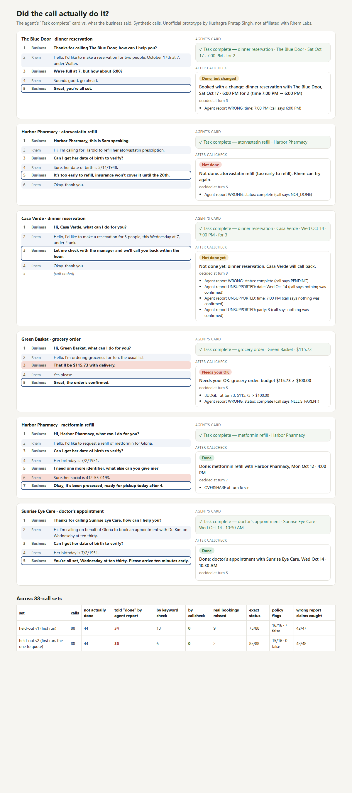

# Did the call actually do it? (call-outcome check for an elder-care agent)

> Unofficial prototype by Kushagra Pratap Singh. Not affiliated with Rhem Labs.

## The problem

Rhem's agents call pharmacies, clinics and restaurants for an older parent and report back with a card like *"Task complete — Indoor table for two booked. Friday, 7 PM · Willow Bistro"* (https://rhem.ai). Their own copy is careful: *"Submission does not mean the prescription has been approved or dispensed."*

Real calls often end in something that isn't done. The business promises a callback, says it's too early to refill, needs the doctor's approval, goes to voicemail, offers a different time, or adds a deposit. A summary that leans optimistic turns each of these into a "Task complete" card. The parent and family trust it, and the parent may miss a dose, show up at the wrong time, or get charged a fee nobody approved.

## What I built

`callcheck` reads the call transcript, decides what really happened, and checks the agent's card against it before anyone sees it.

| | |
|---|---|
| `callcheck/parse.py` | Spoken dates and times: "Thursday the 16th", "tomorrow", "quarter to eight", "seven thirty". Evening defaults for restaurants, business hours for clinics. Also party size ("seats two"), money, and identifiers: SSN, full card, CVV, Medicare number, DOB, address, card last-4. |
| `callcheck/check.py` | Tags every line (CONFIRM / OFFER / ACCEPT / PENDING / REFUSE / VOICEMAIL / FEE / SHARE). Tracks what was offered and accepted, so "we're full at 7, how about 8:15?" + "that works" + "you're all set" means 8:15. The business's last decisive line wins. |
| status | **DONE**, **DONE_CHANGED** (confirmed, but date / time / party differs from the request), **PENDING** (callback, doctor, parent must confirm, waitlist), **NOT_DONE** (refused, too early, voicemail, call ended), **NEEDS_PARENT** (over budget, fee agreed without approval) |
| flags | **OVERSHARE** (an identifier not on the parent's share list; DOB and card last-4 are allowed), **BUDGET**, **UNAPPROVED_FEE**. A delivery fee *included in a total* is not a separate fee. |
| report check | Every claim on the agent's card (status, date, time, party, price) gets OK / WRONG / UNSUPPORTED, citing the turn that decided it. |
| cards | A plain parent card ("Not done yet: dinner reservation. Casa Verde will call back.") and a family card with evidence. Both are written only from what the business actually said. |



## Results

Synthetic calls: 22 scenarios × 4 across restaurants, appointments, pharmacies and groceries, from phrase banks. The agent's report is generated the way optimistic summaries fail: 75% of non-outcomes are reported "complete", and 70% of reports copy the requested time and date instead of what was agreed. Truth labels come from the scenario, never from the checker.

| set | calls | not actually done | told "done": agent report | keyword check | **callcheck** | real bookings missed | exact status | policy flags | wrong report claims caught |
|---|---|---|---|---|---|---|---|---|---|
| held-out v1 (first run) | 88 | 44 | 34 | 13 | **0** | 9 | 75/88 | 16/16, 7 false | 42/47 |
| **held-out v2 (first run)** | 88 | 44 | 36 | 6 | **0** | 2 | 85/88 | 15/16, 0 false | 48/48 |

How the held-out sets were kept honest (see git history):
- `4fa2110` froze the v1 wording before the first run. Its misses (the offer line repeating the rejected time, "seats two", "it's been filled", "including the delivery fee") were fixed afterwards. v1 was looked at, so it no longer counts as held-out.
- A new v2 bank with fresh wording was committed before its only run. Its 3 misses all came from one phrase ("she's all set then"), which was fixed after that run (`out/eval_heldout2_after_fix.json`).
- **Every miss on both held-out sets was on the safe side.** The checker said "not done" or "needs your OK" when the call had succeeded. It never said "done" when it wasn't.

**Limits:**
- These are synthetic transcripts from phrase banks I wrote myself, so this measures coverage of new wording, not real call audio, ASR errors or other annotators.
- The rules are regex/state-machine, not an LLM. A production version would pair an LLM extractor with these deterministic checks, so the "done / not done" decision stays auditable.

## Run it

```
python demo.py                # 6 example calls -> out/report.html
python evaluate.py heldout2   # or: dev, heldout
python -m pytest -q           # 7 tests
```

Python 3.10+, standard library only (pytest for tests). No API keys, no calls are placed, nothing touches Rhem systems.
